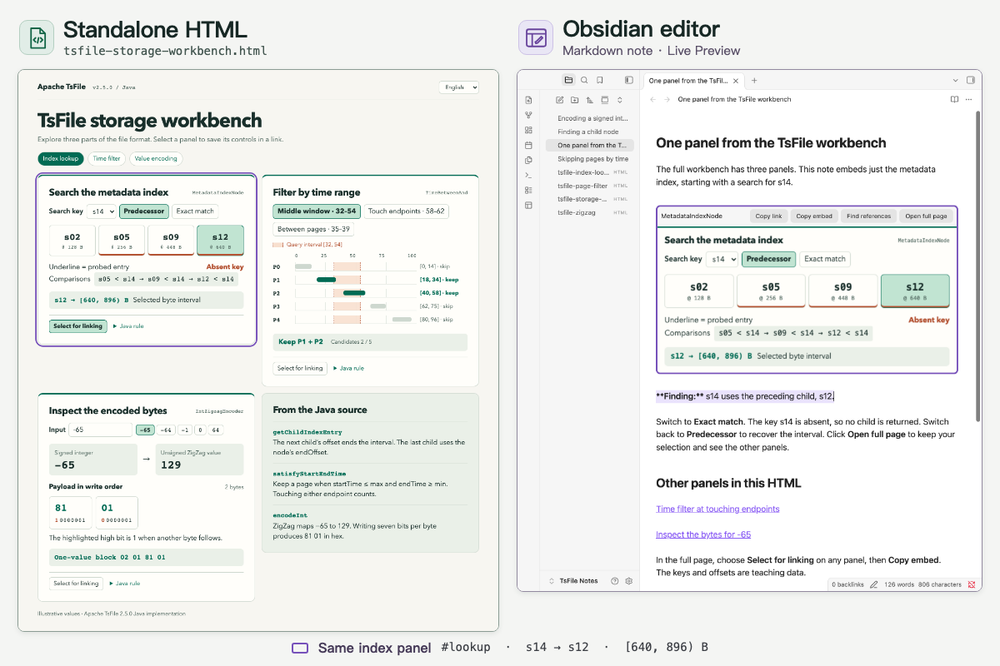
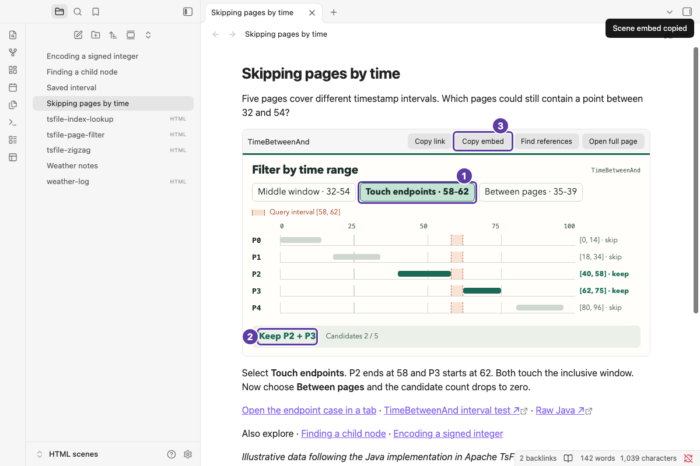
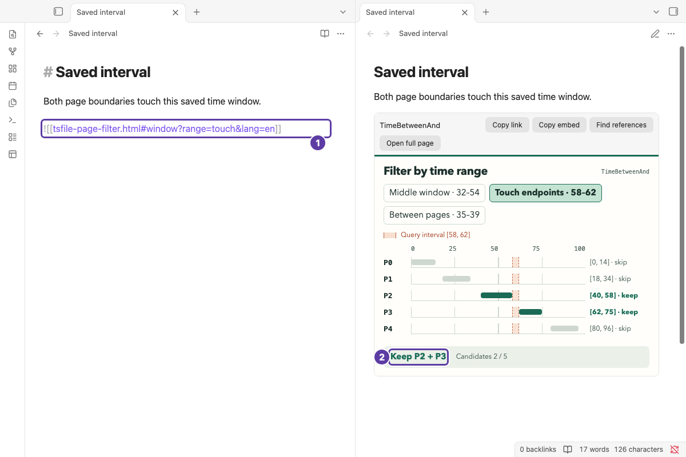
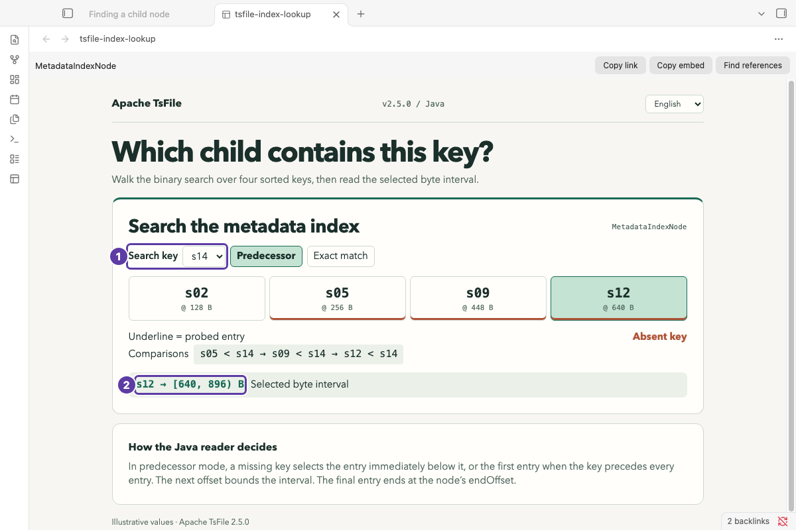
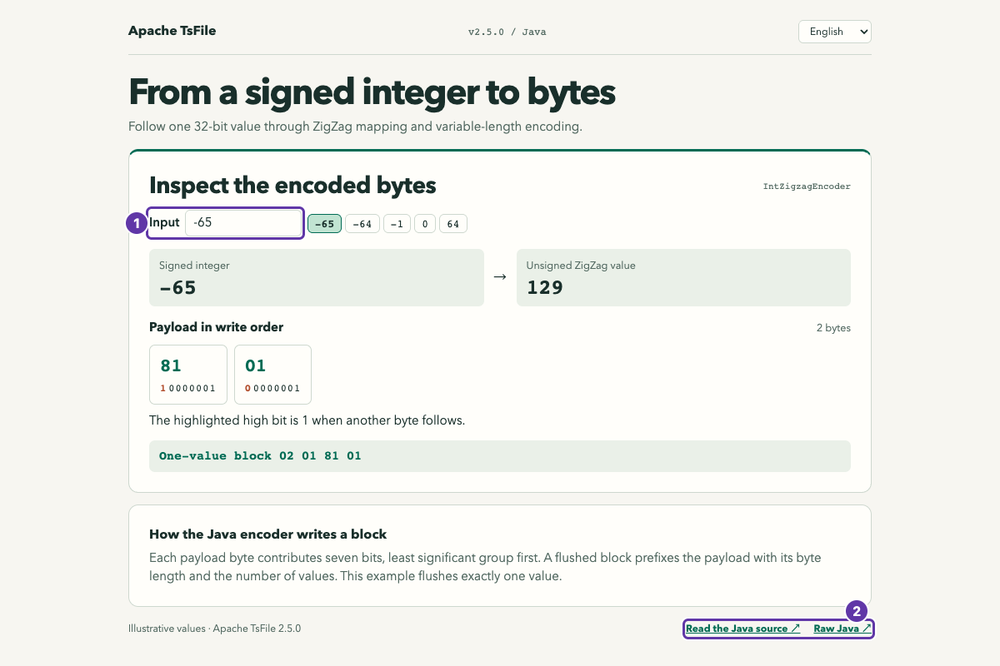
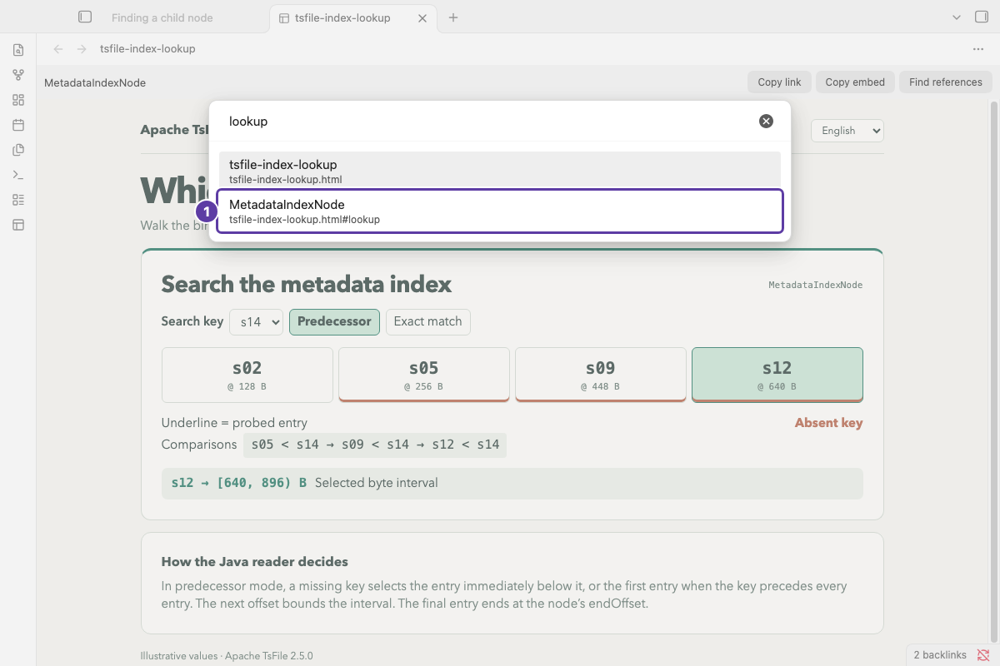
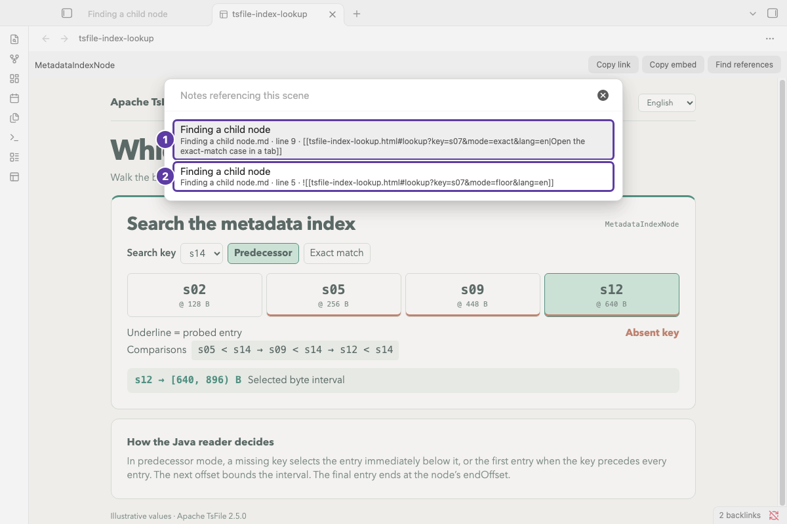
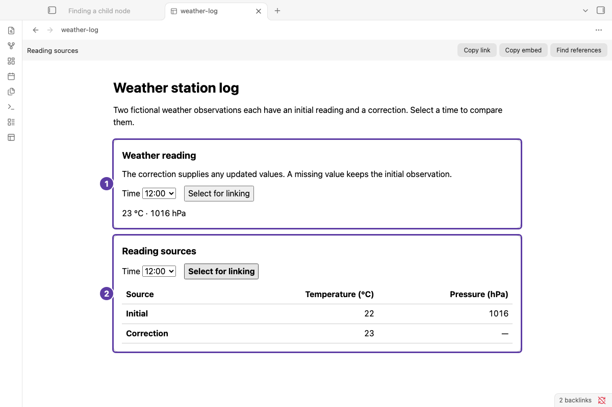

# Interactive HTML Embeds

[简体中文](README.zh-CN.md) · [Authoring skill](#make-a-page-with-the-authoring-skill)

Embed an HTML page or one of its named interactive panels in an Obsidian note. Change a control, then copy the embed to reopen the same selection in another note.

The [TsFile storage workbench](examples/tsfile/tsfile-storage-workbench.html) has three interactive panels for index lookup, time filtering and integer encoding. A note can embed any one of them.

[](docs/screenshots/tour/en/one-panel@2x.png)

The purple outlines mark the same `#lookup` panel. In Obsidian’s Live Preview, you can switch between **Predecessor** and **Exact match**, then type your finding directly below the result.

To copy another panel into a note, open the HTML file in Obsidian, choose **Select for linking** on that panel, then **Copy embed**.

```md
![[tsfile-storage-workbench.html#lookup?key=s14&mode=floor&lang=en]]
```

Copy the workbench and its [companion note](examples/tsfile/en/One%20panel%20from%20the%20TsFile%20workbench.md) into a vault to try it.

## Save an interaction in a note

[](docs/screenshots/tour/en/inline.png)

**①** Choose **Touch endpoints** in the note. **②** The chart keeps pages **P2** and **P3**. **③** Click **Copy embed** to capture that interval.

## What gets saved?

The embed contains the HTML filename, the scene ID (`window`), and its parameters. Here `range=touch` restores the 58–62 interval, and `lang=en` selects English.

```md
![[tsfile-page-filter.html#window?range=touch&lang=en]]
```

[](docs/screenshots/tour/en/restore.png)

**①** The copied Markdown in Source mode. **②** The same note in Reading view. The reader can change the chart again and copy another selection.

## Follow a scene beyond the note

| Open a large page | Open the HTML in a browser |
| --- | --- |
| [](docs/screenshots/tour/en/full-page.png) | [](docs/screenshots/tour/en/standalone.png) |
| **Open full page** keeps the search key **①** `s14` and shows its child byte range **②** `[640, 896)`. | Open the HTML file directly. Enter **①** `-65` to see the bytes `81 01`. Follow **②** **Raw Java** to the implementation. |

## Find a scene or trace a reference

| Search by scene | Find where it was cited |
| --- | --- |
| [](docs/screenshots/tour/en/search.png) | [](docs/screenshots/tour/en/references.png) |
| Run **Find HTML scenes** and type `lookup`. The boxed result **①** opens the named scene. | Click **Find references**. This note has **①** a regular link on line 9 and **②** an inline embed on line 5. Select a result to go to the note. |

To try these screenshots, copy the [TsFile examples](examples/tsfile/) into your vault and open [Skipping pages by time](examples/tsfile/en/Skipping%20pages%20by%20time.md) in Reading view or Live Preview. The [bilingual gallery](docs/screenshots/tsfile/README.md) includes the original screenshots and the external Java source.

## Make a page with the authoring skill

The plugin displays HTML in Obsidian. The **`obsidian-html-scenes`** skill guides a coding assistant that creates or adapts that HTML. Give it data or an existing page, identify a part readers might cite, and say which choices a link should remember. The [skill instructions](skills/obsidian-html-scenes/SKILL.md) and [single-file template](skills/obsidian-html-scenes/assets/weather-log.html) are included in this repository.

If your assistant already has the skill installed, you can ask for `obsidian-html-scenes` by name. Try this prompt in a checkout of the repository.

> Read `skills/obsidian-html-scenes/SKILL.md`. Use the sample observations from its linked weather template. Make two scenes, one for the corrected weather reading and one for its source rows. Each link should remember the selected time. Give me the self-contained HTML and a Markdown note that embeds the noon reading and links to its sources.

[](docs/screenshots/tour/en/authoring.png)

In the bundled example, **①** `reading` shows **23 °C · 1016 hPa** at noon. **②** `sources` shows where each value came from. The note can embed just the reading and link to its evidence in the same file.

```md
![[weather-log.html#reading?time=12%3A00]]
[[weather-log.html#sources?time=12%3A00|Compare the two noon observations]]
```

Try the finished example by copying [weather-log.html](skills/obsidian-html-scenes/assets/weather-log.html) and [Weather notes.md](<examples/Weather notes.md>) into one vault folder. Select **08:00** in the card, copy the embed, and paste it into another note. It reopens at **17 °C · 1015 hPa**.

If you write the HTML yourself, declare stable scene IDs in the static catalog, restore the incoming parameters, and report the active scene after each interaction. The [authoring protocol](skills/obsidian-html-scenes/SKILL.md#connect-the-page) covers messages and inline sizing. The plugin ID and message namespace are `html-scenes`.

## Install from GitHub

Download `main.js`, `manifest.json` and `styles.css` from the [latest release](https://github.com/ColinLeeo/embeds-html-notes/releases/latest). Place them in the `plugins/html-scenes/` folder of your vault's configuration directory, then enable **Interactive HTML Embeds** under **Settings → Community plugins**. With the default configuration directory, the installation path is `.obsidian/plugins/html-scenes/`. Requires Obsidian 1.15.1 or later. Desktop Reading view and Live Preview have been tested. Mobile support is unverified.

## Files and privacy

The plugin reads HTML and Markdown link metadata from the open vault. It uses an iframe with `sandbox="allow-scripts"` and an opaque origin, so the embedded page has no direct access to the Obsidian plugin API. Opening an HTML file runs its scripts. Use files you trust. Documents can request external resources if their HTML references them and the host permits the request. Inline scripts, styles, images and data for a portable offline archive. Relative resource links in sibling files do not resolve against the vault in this version.

The plugin itself uses no remote service, account or telemetry. Clipboard writes happen when you copy a link or embed. A saved link restores the parameters against the current HTML file. Archive the matching data if future readers need the original result.

## Source and license

`main.js` is the complete plugin source and the release artifact. It uses the Obsidian runtime directly and requires no build step. The release also contains the root manifest and stylesheet.

[Apache License 2.0](LICENSE)
