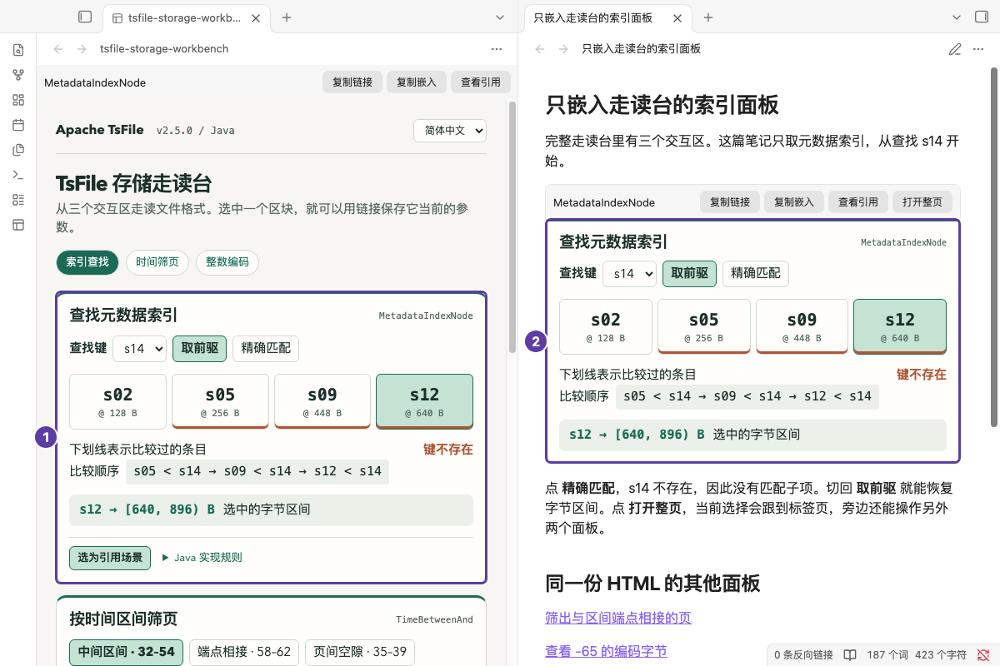
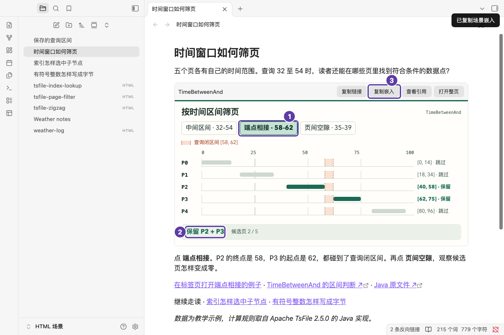
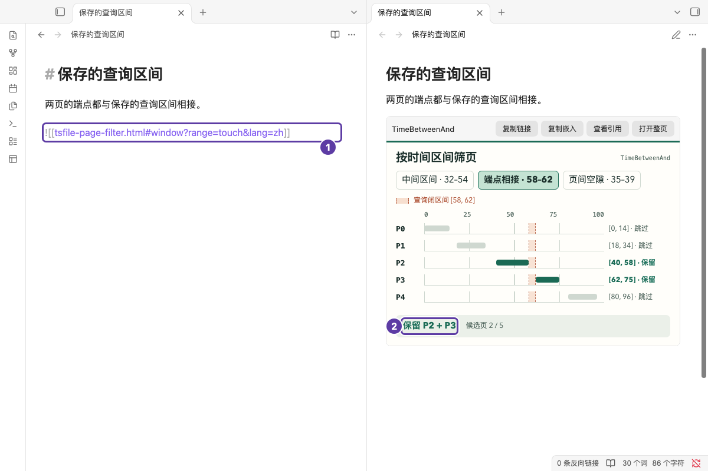
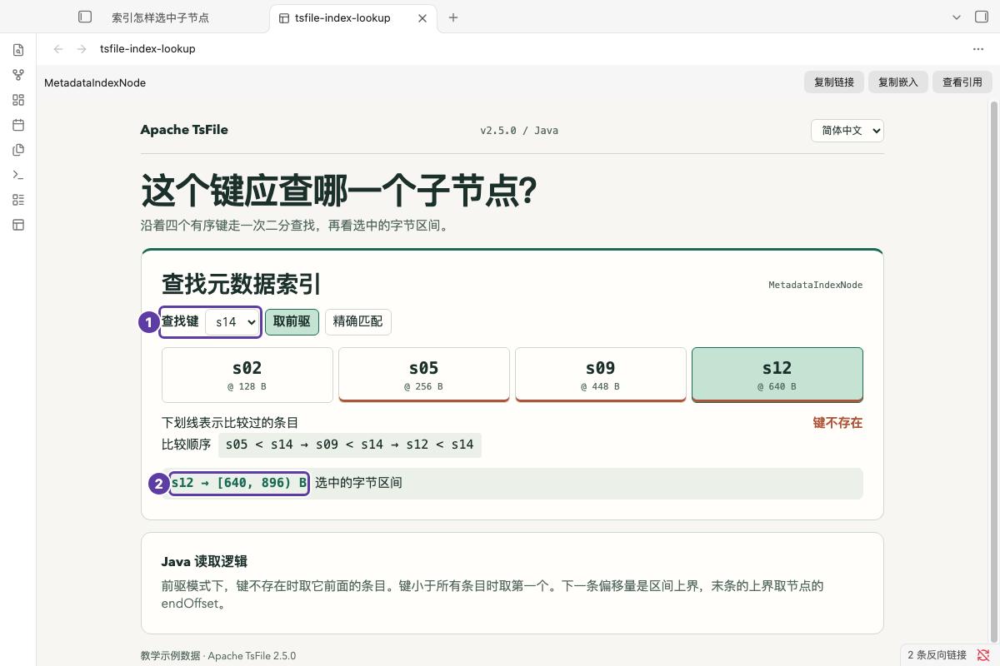
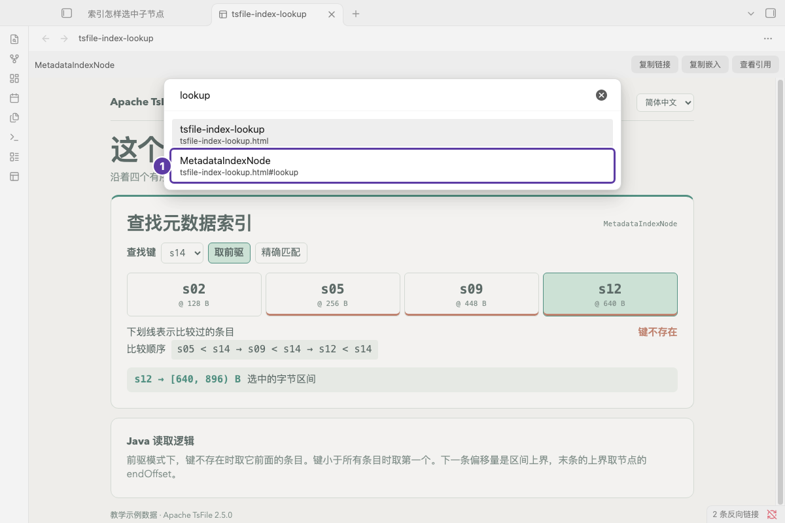
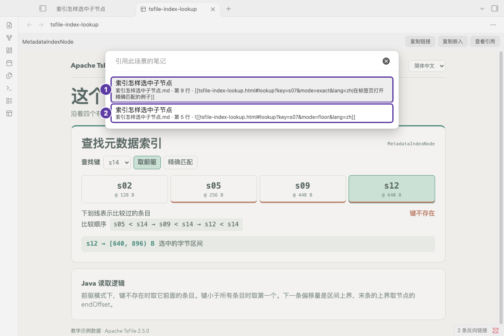
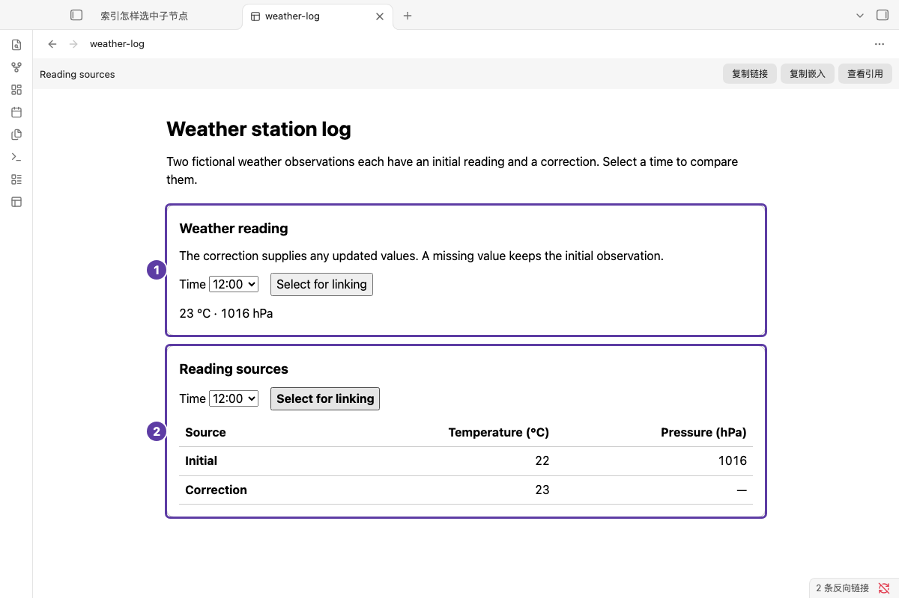

# Interactive HTML Embeds

[English](README.md) · [用 skill 创作页面](#用-skill-创作页面)

在 Obsidian 笔记里嵌入完整的 HTML 页面，也可以只嵌入其中一个命名交互面板。调整控件后，点「复制嵌入」，另一篇笔记就能从同一个选择开始。

[TsFile 存储走读台](examples/tsfile/tsfile-storage-workbench.html)把索引查找、时间筛页、整数编码放在一个 HTML 文件里。笔记可以单独引用其中任何一个交互区。

[](docs/screenshots/tour/zh/one-panel.png)

**①** 左边整页里，在索引面板点「选为引用场景」，再点「复制嵌入」。**②** 右边正文只打开这个面板，查找键和模式都保留。在正文切到「精确匹配」，再点「打开整页」，刚才的选择也会跟过去。

```md
![[tsfile-storage-workbench.html#lookup?key=s14&mode=floor&lang=zh]]
```

把走读台和[配套笔记](examples/tsfile/zh/%E5%8F%AA%E5%B5%8C%E5%85%A5%E8%B5%B0%E8%AF%BB%E5%8F%B0%E7%9A%84%E7%B4%A2%E5%BC%95%E9%9D%A2%E6%9D%BF.md)放进同一个知识库，即可试用。

## 把一次操作存进笔记

[](docs/screenshots/tour/zh/inline.png)

**①** 点「端点相接」。**②** 图里保留了 **P2 和 P3**。**③** 点「复制嵌入」，把这个时间区间带到另一篇笔记。

## 复制下来的是什么？

嵌入文本包含 HTML 文件名、场景 ID 和参数。这里的 `window` 是场景，`range=touch` 恢复 58–62 的区间，`lang=zh` 指定中文。

```md
![[tsfile-page-filter.html#window?range=touch&lang=zh]]
```

[](docs/screenshots/tour/zh/restore.png)

**①** 左边是源码模式中的嵌入文本。**②** 右边是同一篇笔记的阅读视图。读者可以继续点选图表，再复制一个不同的状态。

## 正文以外怎么查看？

| 在 Obsidian 打开整页 | 在浏览器独立操作 |
| --- | --- |
| [](docs/screenshots/tour/zh/full-page.png) | [](docs/screenshots/tour/zh/standalone.png) |
| 点「打开整页」，查找键 **①** 仍是 `s14`，对应的子节点字节区间 **②** 是 `[640, 896)`。 | 直接打开 HTML 文件。**①** 输入 `-65` 可看到载荷 `81 01`。**②** 点「Java 原文件」查看编码器实现。 |

## 怎样找到场景和引用它的笔记？

| 按场景搜索 | 反查引用位置 |
| --- | --- |
| [](docs/screenshots/tour/zh/search.png) | [](docs/screenshots/tour/zh/references.png) |
| 从命令面板运行「搜索 HTML 场景」，输入 `lookup`。选择 **①** 带 `#lookup` 的结果可直接打开该场景。 | 点「查看引用」。这里的 **①** 是第 9 行的普通链接，**②** 是第 5 行的嵌入。点选结果即可返回笔记。 |

要复现这些图，把整个 [TsFile 示例目录](examples/tsfile/) 复制到知识库，在阅读视图或实时预览里打开[时间窗口如何筛页](examples/tsfile/zh/时间窗口如何筛页.md)。[中英文原图集](docs/screenshots/tsfile/README.md)也收录了外链打开后的 Java 源码画面。

## 用 skill 创作页面

插件负责在 Obsidian 里展示 HTML。**`obsidian-html-scenes`** 是给编程助手的创作指南。给它数据或现有 HTML，告诉它哪一块值得单独引用，以及链接需要记住哪些选择。仓库附有 [SKILL.md](skills/obsidian-html-scenes/SKILL.md) 和[单文件模板](skills/obsidian-html-scenes/assets/weather-log.html)。

如果编程助手已经装好这个 skill，可以在请求里直接点名 `obsidian-html-scenes`。在仓库里，可以直接把下面这段话交给编程助手。

> 读 `skills/obsidian-html-scenes/SKILL.md`，用其中链接的天气模板里的观测值做一个走读。做两个可引用的场景，一个显示修正后的读数，另一个列出原始值和修正值。链接要记住选中的时间。给我一份独立 HTML 和一篇 Markdown，正文嵌入正午读数，再链接到同一时刻的来源表。

[](docs/screenshots/tour/zh/authoring.png)

图中是仓库自带的英文模板。正午时，**①** `reading` 给出 **23 °C、1016 hPa**。**②** `sources` 能看出温度来自修正记录，气压沿用初始观测。可以把结果嵌进正文，给来源表留一个链接。

```md
![[weather-log.html#reading?time=12%3A00]]
[[weather-log.html#sources?time=12%3A00|查看正午读数的来源]]
```

把 [weather-log.html](skills/obsidian-html-scenes/assets/weather-log.html) 和 [Weather notes.md](<examples/Weather notes.md>) 放进知识库的同一目录即可试用成品。在卡片里选 **08:00**，复制嵌入到另一篇笔记，新卡片会显示 **17 °C、1015 hPa**。

手写 HTML 时，在静态场景目录里声明稳定 ID，打开页面时还原参数，用户操作后回报当前场景与参数。消息格式和嵌入高度见[创作协议](skills/obsidian-html-scenes/SKILL.md#connect-the-page)。插件 ID 和消息命名空间都是 `html-scenes`。

## 从 GitHub 安装

从[最新发布页](https://github.com/ColinLeeo/embeds-html-notes/releases/latest)下载 `main.js`、`manifest.json` 和 `styles.css`，放入知识库配置目录下的 `plugins/html-scenes/`。默认路径是 `.obsidian/plugins/html-scenes/`。在「设置 → 第三方插件」启用 **Interactive HTML Embeds**。要求 Obsidian 1.15.1 或更新版本，已验证桌面阅读视图和实时预览，移动端尚待验证。

## 文件与隐私

插件从当前知识库读取 HTML 和 Markdown 链接信息。HTML 在允许脚本的沙箱 iframe 中运行，请使用可信文件。页面引用外部资源时可能发起请求，离线归档时应内联脚本、样式、图片和数据。当前版本的相对资源路径无法定位到知识库里的相邻文件。

插件本身无需账户，没有远程服务或遥测。点击复制时才会写入剪贴板。保存的链接会把参数应用到当前版本的 HTML，需要复现历史结果时请一并归档数据。

## 源码与许可

`main.js` 同时是完整的插件源码和发布文件，无需构建。[Apache License 2.0](LICENSE)
