# Apache TsFile walkthroughs · TsFile 源码交互走读

Copy the entire [tsfile example folder](../../../examples/tsfile/) into your vault. Open a note below in Reading view or Live Preview. Each pair of notes shares one standalone HTML file.

把整个 [tsfile 示例目录](../../../examples/tsfile/) 复制进知识库，在阅读视图或实时预览里打开下表中的笔记。每组中英文笔记共用一份 HTML。

| English note | 中文笔记 |
| --- | --- |
| [Skipping pages by time](../../../examples/tsfile/en/Skipping%20pages%20by%20time.md) | [时间窗口如何筛页](../../../examples/tsfile/zh/%E6%97%B6%E9%97%B4%E7%AA%97%E5%8F%A3%E5%A6%82%E4%BD%95%E7%AD%9B%E9%A1%B5.md) |
| [Finding a child node](../../../examples/tsfile/en/Finding%20a%20child%20node.md) | [索引怎样选中子节点](../../../examples/tsfile/zh/%E7%B4%A2%E5%BC%95%E6%80%8E%E6%A0%B7%E9%80%89%E4%B8%AD%E5%AD%90%E8%8A%82%E7%82%B9.md) |
| [Encoding a signed integer](../../../examples/tsfile/en/Encoding%20a%20signed%20integer.md) | [有符号整数怎样写成字节](../../../examples/tsfile/zh/%E6%9C%89%E7%AC%A6%E5%8F%B7%E6%95%B4%E6%95%B0%E6%80%8E%E6%A0%B7%E5%86%99%E6%88%90%E5%AD%97%E8%8A%82.md) |

The [storage workbench](../../../examples/tsfile/tsfile-storage-workbench.html) puts all three panels in one file. Open [One panel from the TsFile workbench](../../../examples/tsfile/en/One%20panel%20from%20the%20TsFile%20workbench.md) or [只嵌入走读台的索引面板](../../../examples/tsfile/zh/只嵌入走读台的索引面板.md) to embed the index on its own.

The notes set `lang=en` or `lang=zh` in the scene link. Opening an HTML file directly lets you change the language in the page header. The sample values are illustrative. Each source link points to the Apache TsFile 2.5.0 implementation.

笔记用 `lang=en` 或 `lang=zh` 指定页面语言。直接打开 HTML 时可用页首选择器切换。数据为教学示例，源码链接固定到 Apache TsFile 2.5.0。

## Read a scene inside Markdown · 正文内查看

The query [32, 54] selects P1 and P2.

查询 [32, 54] 时，候选页为 P1、P2。

| English | 简体中文 |
| --- | --- |
| [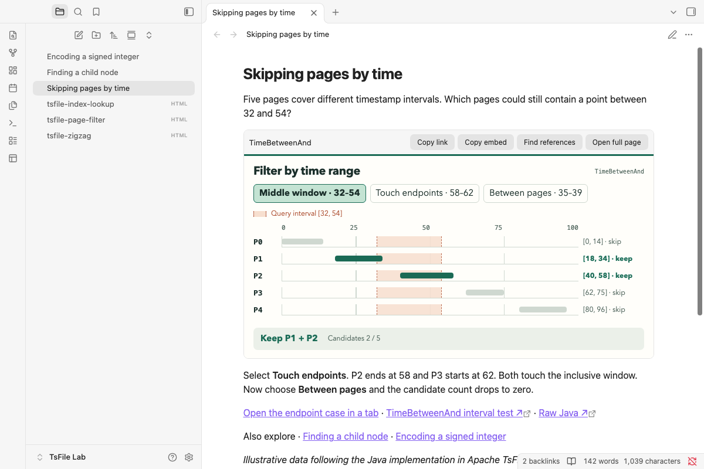](en/en-01-inline.png) | [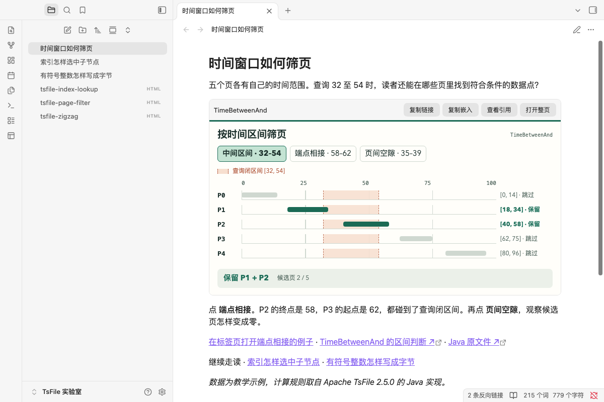](zh/zh-01-inline.png) |

## Interact and copy the selection · 正文内交互并复制

After clicking Touch endpoints, the chart selects P2 and P3. Copy embed captures that interval.

点击「端点相接」后，候选页变为 P2、P3。「复制嵌入」保留这个区间。

| English | 简体中文 |
| --- | --- |
| [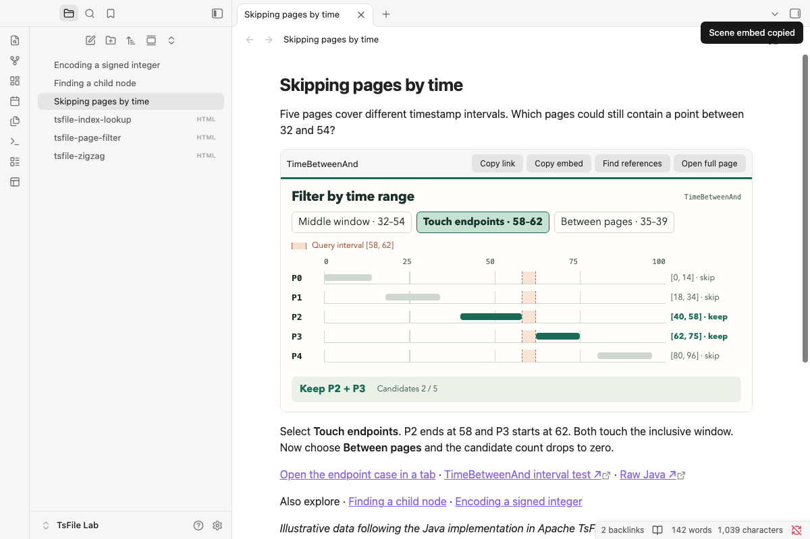](en/en-02-interaction.png) | [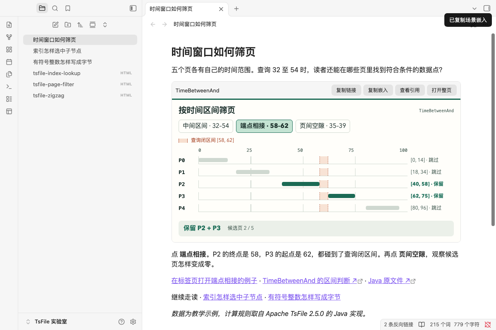](zh/zh-02-interaction.png) |

## Expand the current selection · 带着状态打开整页

Open full page carries the selected key s14 into a dedicated tab. The last child covers [640, 896) bytes.

点击「打开整页」，标签页保留 s14 这个查找键。末项选中 [640, 896) 字节。

| English | 简体中文 |
| --- | --- |
| [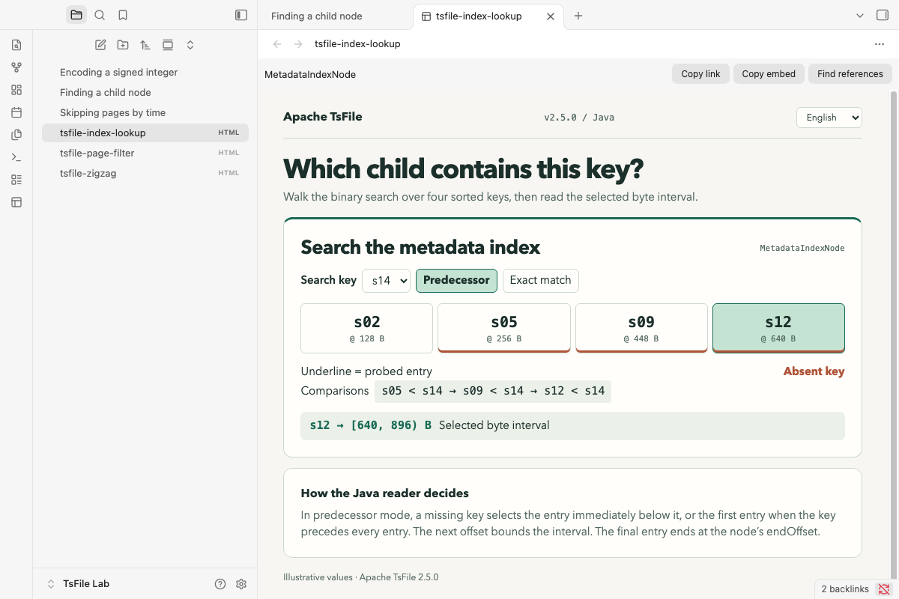](en/en-03-full-page.png) | [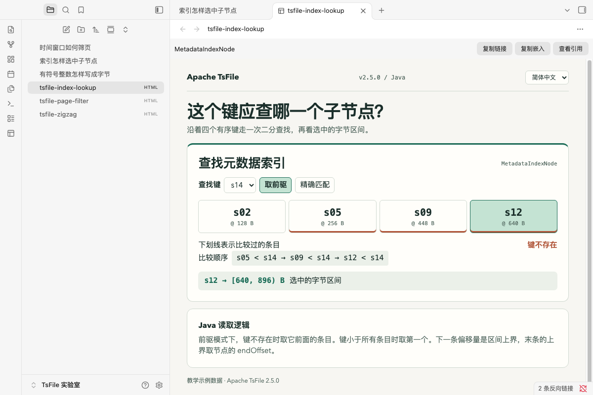](zh/zh-03-full-page.png) |

## Find the notes that refer to the scene · 反查笔记中的引用

Find references lists the link and embed in the index note, with their line numbers.

「查看引用」列出索引笔记里的链接和嵌入，显示各自的行号。

| English | 简体中文 |
| --- | --- |
| [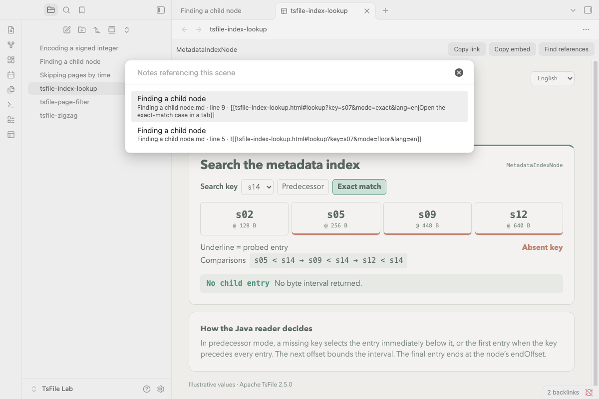](en/en-04-references.png) | [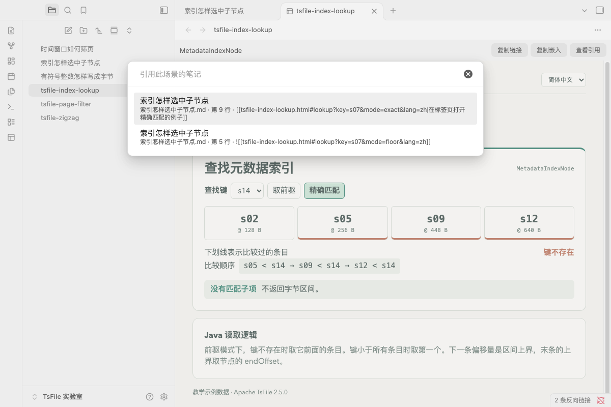](zh/zh-04-references.png) |

## Use the HTML in a browser · 在浏览器独立交互

Chrome opens the same HTML file. Selecting -65 yields the payload 81 01. Raw Java opens the source in another tab.

Chrome 直接打开同一份 HTML。选 -65 得到载荷 81 01，点击「Java 原文件」可在新标签页查看实现。

| English | 简体中文 |
| --- | --- |
| [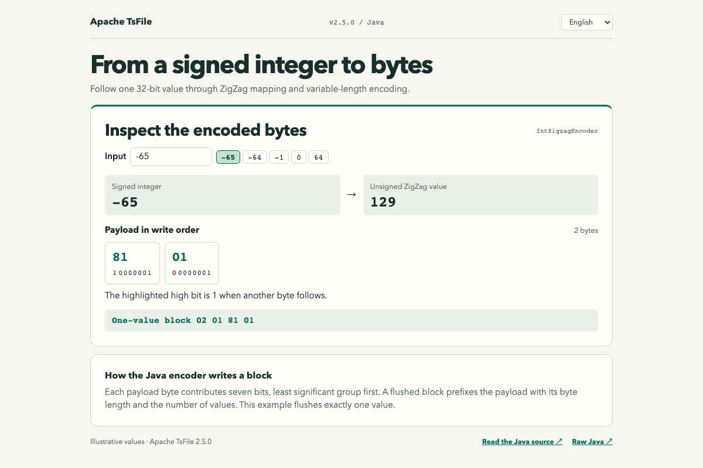](en/en-05-browser.png) | [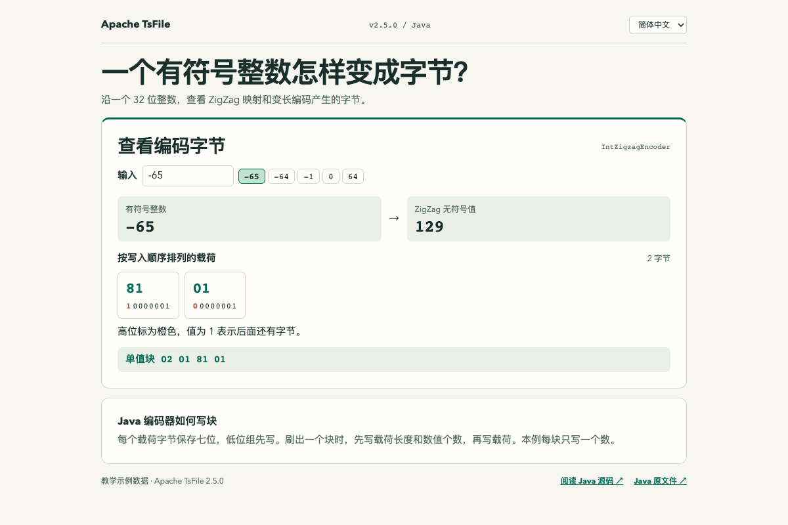](zh/zh-05-browser.png) |

## External source · 外链落点

The Raw Java link opens the original `IntZigzagEncoder.java`. Both language versions lead to the same file.

点击「Java 原文件」后，浏览器打开原始 Java 代码。两种语言共用这个外链。

[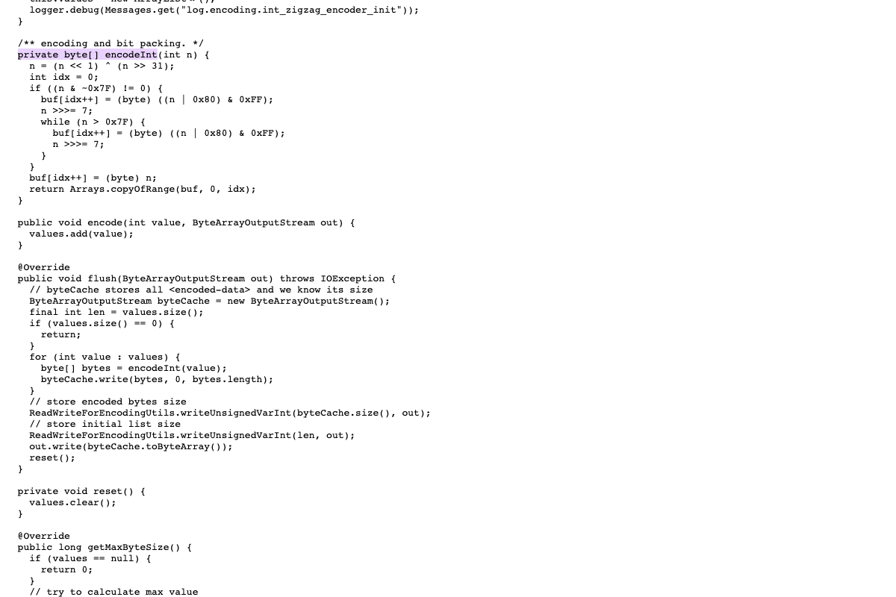](tsfile-zigzag-source.png)
